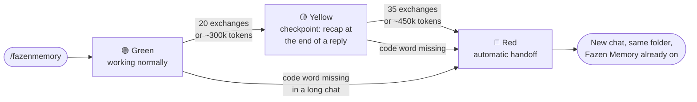
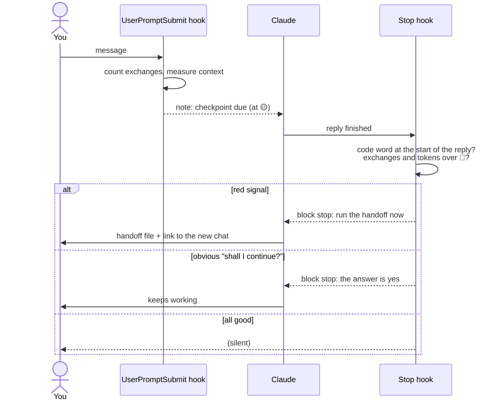
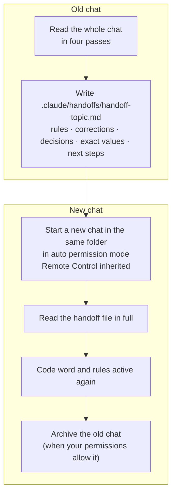

# Fazen Memory

**Long Claude Code chats drift. Fazen Memory notices, and moves the work to a fresh chat before it does.**

[](https://code.claude.com/docs/en/plugins)
[](LICENSE)


In a long chat, rules given early get forgotten and corrections get quietly undone. Fazen Memory
watches every chat with two small hooks. When the chat gets too long, or Claude stops following the
rules, it writes a complete handoff file and continues in a new chat in the same folder. The handoff
carries every rule, correction and exact value over, so nothing is lost.

## How it works

Fazen Memory is **off** in every chat until you type `/fazenmemory`. Once it is on, every exchange
moves the chat along three levels:



- **Code word.** Claude starts every reply with a fixed phrase (default **Yes Brother!** in English,
  **Si Fratello!** in Italian). If a reply misses it, the chat is losing track of its rules. In a
  long chat (10+ exchanges or ~200k tokens) that triggers the handoff.
- **Checkpoint** 🟡 at 20 exchanges or ~300k context tokens: Claude adds a compact recap to the end
  of its reply, which brings the early decisions back into focus.
- **Automatic handoff** 🔴 at 35 exchanges, ~450k context tokens, or a missing code word. It
  happens once per chat.
- **Auto-continue.** No more "Shall I continue with step 2?". An obvious continuation question is
  answered yes for you, at most 5 times per message. Never for merge, production, money, legal,
  sending anything, deleting, or "A or B?" choices.

Chats opened by a handoff start with Fazen Memory already on. With nobody watching the chat
(`claude -p`, scheduled tasks), Fazen Memory only warns: it never forces a handoff or answers yes.

### Under the hood

Two hooks do the watching. The phrase itself is never sent to Claude after the first turn, so the code
word stays a real test of memory.



### The handoff



The handoff file has 14 fixed sections (0 to 13): instructions for the new chat, mission, the user's style,
hard rules word for word, corrections, decisions, rejected ideas, exact data, names, work state, next
steps, open questions and files to re-attach. Secrets are removed before it is written.

### How the new chat opens

Fazen Memory uses the first way your Claude Code offers:

| Way | What you do | Where the new chat is |
|---|---|---|
| Session tools | nothing | the app's sidebar |
| Chip | one click on the chip ("Inizia worktree" in the Italian app) | the app's sidebar, in its own git worktree |
| Terminal tab (fallback) | nothing, or confirm "trust this folder" the first time | the Terminal panel of the old chat, **not** the sidebar |

A worktree does not see uncommitted changes, so before the chip Fazen Memory asks whether to commit
them. It does not switch to a Terminal tab to avoid the worktree: a chat outside the sidebar is easy
to lose.

**Remote Control is inherited.** If the old chat is connected to Remote Control, the new one connects
too, so you can follow it from claude.ai/code or the Claude app. In the desktop app you can also turn on
**Connect new sessions to Remote Control** in Settings.

**Model and effort are inherited.** The new chat runs on the same model and effort as the old one
(the Terminal tab gets `--model` and `--effort`), so it never starts at a lower effort by default.

## Install

Requires Claude Code 2.1.271 or later, bash (on Windows, Git Bash) and Python 3.8+ (`python3`,
`python` or `py`).

In a Claude Code session (2.1.275 or later):

```text
/plugin install fazen-memory --marketplace fazendev/fazen-memory
```

Or from your shell (2.1.292 or later):

```bash
claude plugin install fazen-memory --marketplace fazendev/fazen-memory
```

On older versions, add the marketplace first, then install:

```bash
claude plugin marketplace add fazendev/fazen-memory
claude plugin install fazen-memory@fazen-memory
```

The desktop app reads the same settings as the terminal: once the marketplace is added, the plugin
also appears under **+ > Plugins > Add plugin** in a Code session.

Then open a chat and type `/fazenmemory`.

## Commands

| Command | What it does |
|---|---|
| `/fazenmemory [off\|status]` | Turns Fazen Memory on in this chat, off, or shows its status (with a warning if its saved state keeps getting lost) |
| `/fmcodeword [phrase\|off]` | Changes the code word or turns it off |
| `/fmcheckpoint` | Compact recap + health 🟢🟡🔴 |
| `/fmhandoff [file]` | Handoff file + new chat in the same folder in auto mode (`file` = the file only) |
| `/fmhelp` | Guide, in your language |

Each command also works with the plugin prefix, e.g. `/fazen-memory:fazenmemory`.

## Settings

Asked when you enable the plugin; change them later in `/config` or under **Configure options** in
`/plugin`.

| Option | Values | Default |
|---|---|---|
| Language | `auto`, `english`, `italian` | `auto`: Claude Code's `language` setting, otherwise your system language |
| Default code word | any phrase | empty: **Yes Brother!** in English, **Si Fratello!** in Italian |

Environment variables: `FAZEN_MEMORY_YELLOW_TOKENS` (300000), `FAZEN_MEMORY_RED_TOKENS` (450000),
`FAZEN_MEMORY_AUTO=0` (warnings only, never a forced handoff).

## Privacy

Everything stays on your machine. Per-chat state (on/off, exchange count, code word) is saved in the
plugin's data folder (`~/.claude/plugins/data/`). Handoff files go to
`<project>/.claude/handoffs/`, and Fazen Memory adds that folder to `.gitignore` so they are not
committed.

## Troubleshooting

Type `/fazenmemory status`. It shows what the hooks really recorded: on/off, code word, how many of
this chat's messages they counted, and the state folder.

- **"Warning: the hooks missed N of M messages".** Either the plugin was installed in the middle of
  the chat, or something deletes the state folder. Cleanup scripts or hooks that empty
  `~/.claude/plugins/data/` wipe the state of every plugin, and Fazen Memory restarts from zero each
  time: no checkpoint, no handoff. Exclude that folder from the cleanup.
- **"failed to load ... userConfig.language: Unrecognized key: "options"".** That `claude` is older
  than 2.1.271 (often a separate npm install on the PATH, not the one the desktop app uses). Check
  `claude --version` and update it.
- **No status note at all.** The plugin's hooks are not running. Check that the plugin is enabled in
  `/plugin`, then restart Claude Code.
- **Windows: `python3` fails** with "Failed to launch ... python.exe". The Python install manager
  points to a removed version. Fazen Memory's `run.sh` skips broken entries and uses the first Python
  that starts. Other plugins may not: in `%AppData%\Python\pymanager.json` set `default_tag` to an
  installed version, plus a `shebang_templates` entry for `/usr/bin/env python3` (scripts with that
  shebang ignore `default_tag`).

## Project layout

```text
.claude-plugin/   plugin.json (manifest, settings) · marketplace.json
hooks/            hooks.json · run.sh (finds Python) · on_prompt.py · on_stop.py · state.py
skills/           fazenmemory · fmcodeword · fmcheckpoint · fmhandoff · fmhelp
tests/            test_hooks.py
```

## Development

```bash
python tests/test_hooks.py          # hook tests
claude plugin validate .            # manifest check
claude --plugin-dir .               # load this checkout for one session
```

## License

MIT. See [LICENSE](LICENSE).
